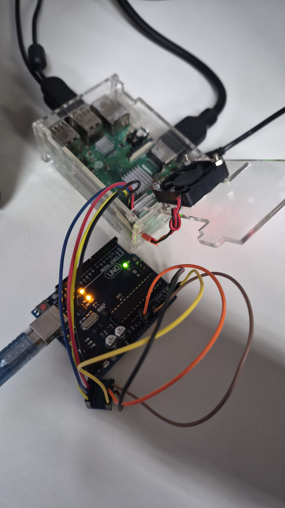

# SEL0337 — Projetos em Sistemas Embarcados

## Prática 4: Protocolos de Comunicação em Sistemas Embarcados de Alto Nível

### Checkpoint 1: Comunicação I2C entre Raspberry Pi e Arduino

---

## Descrição do Projeto

O objetivo desse checkpoint é estabelecer a comunicação serial síncrona utilizando o barramento I2C entre duas placas diferentes:

- **Raspberry Pi:** atua como controlador, executando um script em Python que lê os comandos do usuário pelo terminal e os envia pelo barramento I2C.
- **Arduino Uno:** atua como controlado, recebendo os comandos, controlando o LED e exibindo mensagens no Monitor Serial.

---

## Mapeamento de Hardware

Como a Raspberry Pi utiliza níveis lógicos de **3,3 V**, enquanto o Arduino Uno utiliza **5 V**, foi utilizado um **conversor de nível lógico bidirecional** para adaptar os sinais.

### Conexões

* **Alimentação (3.3V / 5V):**
  * Raspberry Pi: Pino 1 (3.3V) -> Conversor: pino **LV**
  * Arduino Uno: Pino 5V -> Conversor: pino **HV**

* **GND:**
  * Raspberry Pi: Pino 6 ou 9 (GND) -> Conversor: pino **GND** (lado LV)
  * Arduino Uno: Pino GND -> Conversor: pino **GND** (lado HV)

* **Dados (SDA):**
  * Raspberry Pi: GPIO 2 / SDA (Pino 3) -> Conversor: canal **LV3**
  * Arduino Uno: Pino A4 (SDA) -> Conversor: canal **HV3**

* **Clock (SCL):**
  * Raspberry Pi: GPIO 3 / SCL (Pino 5) -> Conversor: canal **LV4**
  * Arduino Uno: Pino A5 (SCL) -> Conversor: canal **HV4**

---


### Execução

1. Conecte o Arduino por USB.
2. Abra o Monitor Serial da Arduino IDE e configure a velocidade para **9600**.
3. No terminal da Raspberry Pi, coloque:

```bash
python3 codigo_python.py
```

4. Digite `1` para acender o LED interno do Arduino.
5. Digite `0` para apagar o LED.
6. Digite outra coisa para desligar o programa.

---

## Demonstração e Validação

### Montagem

A montagem utiliza a Raspberry Pi, o conversor de nível lógico bidirecional e o Arduino Uno.



### Vídeo de demonstração

O funcionamento do sistema pode ser verificado no vídeo, que demonstra o envio dos comandos pela Raspberry Pi, o acionamento do LED do Arduino e as mensagens no Monitor Serial.

[Vídeo de demonstração](video_prova.mp4)
